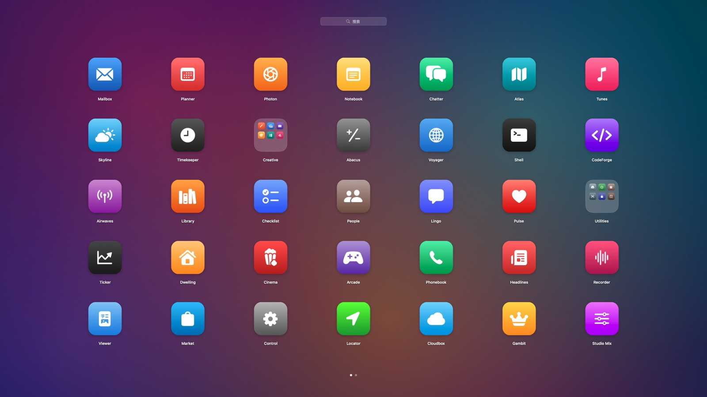
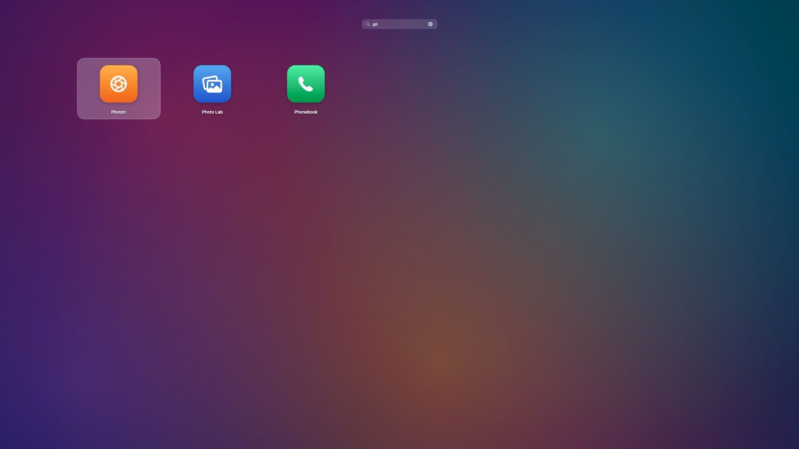
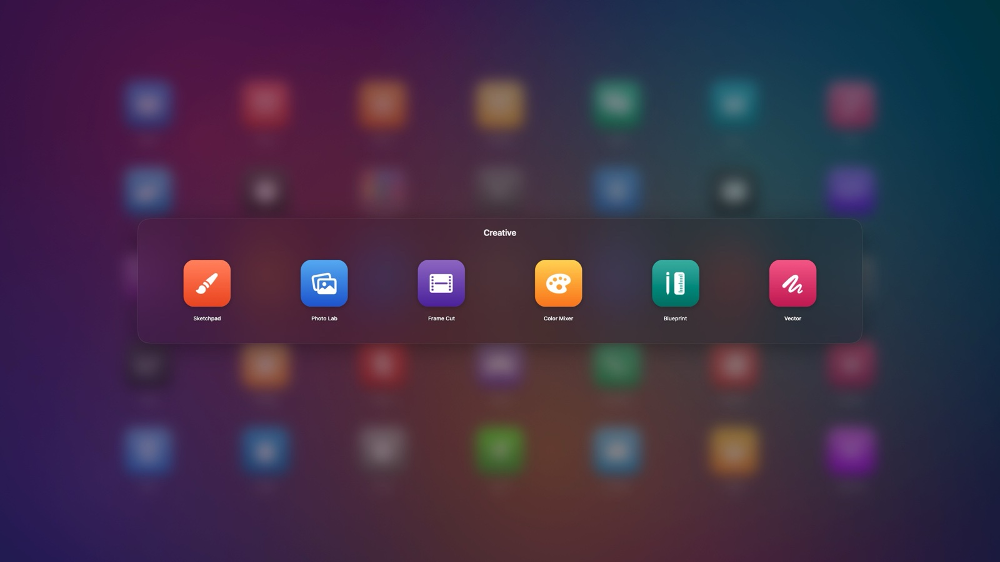
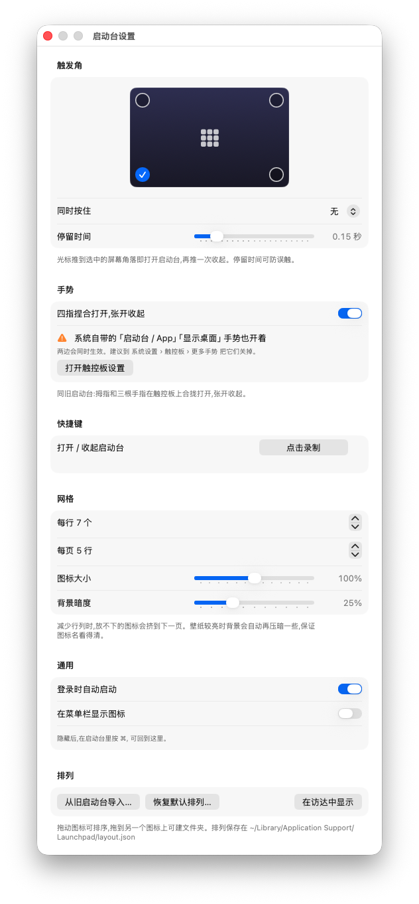

# Launchpad

**English** · [中文](README.zh-CN.md)

[](https://github.com/zxing258974/Launchpad/releases/latest) [](https://github.com/zxing258974/Launchpad/releases)   [](LICENSE)

macOS 26 removed Launchpad. This is a native rebuild of it: a full-screen grid of your apps with pages, search, drag-to-rearrange and folders — plus **its own hot corners** and the four-finger pinch.



<table>
  <tr>
    <td width="50%"></td>
    <td width="50%"></td>
  </tr>
  <tr>
    <td align="center">Search by name, full pinyin or initials</td>
    <td align="center">Folders, opened in place</td>
  </tr>
</table>

<p align="center"></p>

<sub>Screenshots use demo data (fictional apps and a generated wallpaper). Regenerate them with `scripts/screenshots.sh`.</sub>

## Download

1. Grab the latest `Launchpad-x.y.z.dmg` from [Releases](https://github.com/zxing258974/Launchpad/releases), open it and drag Launchpad into Applications (a zip is available too).
2. The build is not notarized by Apple, so macOS blocks the first launch. Go to **System Settings › Privacy & Security**, find Launchpad near the bottom of the page and click **Open Anyway**.
3. Requires macOS 14 or later; universal binary for Apple silicon and Intel. Built mainly for macOS 26, where Launchpad is gone.

The app is localized as 启动台 on Chinese systems; its interface is currently in Chinese.

## Features

- **Ways to open**
  - Hot corners: push the pointer into a screen corner (bottom-left by default; pick any combination, optionally require a modifier key and a dwell time to avoid accidental triggers), push again to close. With multiple displays, only corners where the pointer actually gets "stuck" count.
  - Four-finger pinch (thumb and three fingers) to open, spread to close — just like the original. Raw trackpad contacts are read through the private MultitouchSupport framework; if it can't be loaded, the gesture is simply unavailable.
  - A global keyboard shortcut (record one in Settings; none by default).
  - Click the Launchpad icon in the Dock, Finder or Spotlight, or the menu bar icon.
- **Grid**: 7×5 per page by default, with adjustable rows, columns and icon size. Change pages by swiping on the trackpad, with the mouse wheel, by dragging on empty space, by clicking the page dots, or with ⌘← / ⌘→.
- **Search**: just start typing. Matches localized and English names, and for Chinese names full pinyin and initials too (微信 is found with `wx` or `weixin`; both readings of polyphonic characters are understood). Return opens the first result; arrow keys select.
- **Organize**: drag icons to reorder; hold at a screen edge to flip pages (dragging past the last page creates a new one); hold an app over the center of another and release to make a folder (named after the app category); click a folder name to rename it; drag an app out of the folder panel to remove it. Right-click for Show in Finder and Remove from Folder.
- **Your old layout**: on first launch, the arrangement left behind by the system Launchpad (folders included) is imported automatically. You can re-import it from Settings.
- **Look**: the background is a blurred copy of your desktop picture (the right light/dark frame of dynamic wallpapers; bright wallpapers are dimmed automatically so labels stay readable), or a solid dark fill with Reduce Transparency. Opening, page flips and folders expanding from their icon are animated; with Reduce Motion they cross-fade instead.
- **Keyboard and VoiceOver**: arrow keys to select (inside folders too), Return to open, Tab to rename a folder. VoiceOver can open items, show them in Finder, remove them from folders and move them to the previous or next page.
- **Robust**: an app that briefly disappears while updating or reinstalling keeps its place if it returns within 30 minutes (even across restarts); multiple copies with the same bundle id each keep their own spot.
- **Closing**: Esc (cancels input-method composition, then clears the search, closes the folder, then closes Launchpad), clicking empty space, opening an app, switching apps, or locking the screen. Focus returns to the app you were using.

## Building

Only the Command Line Tools are needed — no Xcode:

```bash
scripts/build-app.sh --install   # build, sign, install to /Applications and launch (native architecture)
scripts/package.sh               # release build: universal binary, ad-hoc signed; dmg, zip and SHA256SUMS.txt in dist/
scripts/screenshots.sh           # regenerate the README screenshots with demo data
open /Applications/Launchpad.app --args --background   # start in the background without showing the grid
scripts/test.sh                  # run all tests
scripts/test.sh --coverage       # with coverage
```

Signing is ad-hoc by default. To sign with a certificate of your own, copy `Config/local.env.example` to `Config/local.env` and set `SIGN_IDENTITY` (that file is git-ignored).

The icon is generated with `swift scripts/make-icon.swift <output.iconset>` and converted with `iconutil -c icns` into `Resources/AppIcon.icns`.

## Before you start

- In **System Settings › Desktop & Dock › Hot Corners**, if the same corner also has another action (the corner that used to open Launchpad is a common one), both will fire — set it to "-". Launchpad's Settings detects this and warns you.
- In **System Settings › Trackpad › More Gestures**, turn off the system's own four-finger pinch (Apps) and spread (Show Desktop); otherwise they fire together with Launchpad's gesture. Settings warns about this too.
- To have it ready after login: Settings › General › Launch at login.
- If you hide the menu bar icon, press ⌘, inside Launchpad to get back to Settings.

## Project layout

```
Sources/LaunchpadCore/   Pure logic, no UI: layout engine, pinyin search, hot-corner geometry and state machine,
                         grid geometry, pinch detector, legacy database reader, app scanner, persistence
Sources/CMultitouch/     Runtime (dlopen) wrapper around the private MultitouchSupport framework
Sources/Launchpad/
  App/        AppDelegate, settings, app catalog and icon cache, launching apps, login item, menu bar, wallpaper
  Overlay/    Full-screen panel and the interaction model (clicks, dragging, folders, paging, keyboard)
  Input/      Panel event routing, hot-corner monitor, global shortcut (Carbon), trackpad pinch monitor
  Views/      SwiftUI views; every position comes from GridMetrics, the same source used for hit-testing
  Settings/   Settings window and shortcut recorder
  Demo/       Demo mode for screenshots (--demo / --demo-scene): fictional apps, icons and wallpaper, isolated from real data
Tests/LaunchpadCoreTests/   Unit tests for the core logic
Tests/LaunchpadAppTests/    Interaction tests driving the panel model's mouse, keyboard and scroll handling against fake app bundles
```

Data: the layout lives in `~/Library/Application Support/Launchpad/layout.json` (backed up and rebuilt automatically if it gets corrupted); settings are in the `com.zhangxing.Launchpad` user defaults.

## Implementation notes

- When the panel opens, the app activates itself with `activate(ignoringOtherApps:)`. Since macOS 14 the newer `activate()` is cooperative and is refused when triggered from a hot corner or shortcut (verified); without activation, the frontmost app can steal keyboard focus from the panel at any time.
- Mouse, trackpad and keyboard input all go through a local event monitor on the panel, so a drag survives the folder panel appearing and disappearing. Keys pressed during input-method composition always go to the input method.
- Rendering and hit-testing share `GridMetrics`; while dragging, only the floating icon under the pointer redraws.

## Known limitations

- The four-finger pinch relies on an undocumented system framework and may stop working after a major macOS update (Settings then shows it as unavailable; nothing else is affected).
- There is no jiggle mode for deleting apps — use Finder to uninstall.
- Only a classic `.icns` icon is included, so macOS 26 puts it on a gray plate at 16/32 px (Finder lists and similar). Fixing that needs Xcode's actool to build an `Assets.car` plus `CFBundleIconName` in Info.plist, which the Command Line Tools alone can't do.

## License

[MIT](LICENSE)

## Acknowledgements

- The trackpad contact data structures and function signatures follow [OpenMultitouchSupport](https://github.com/Kyome22/OpenMultitouchSupport) (MIT, Copyright © 2019 Takuto Nakamura).
